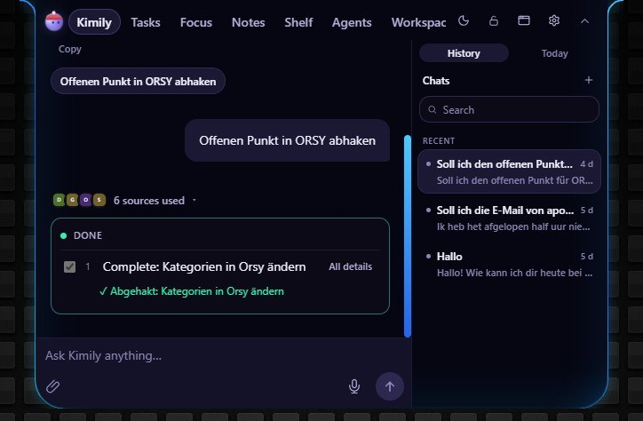
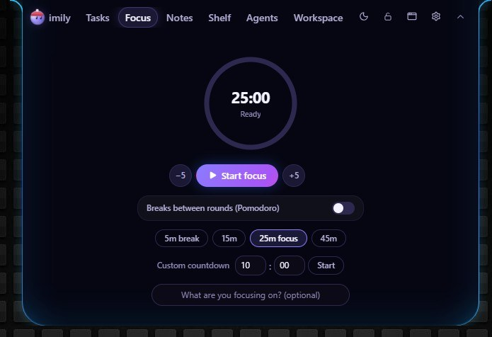
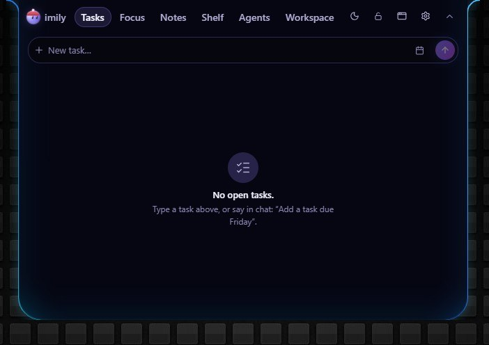
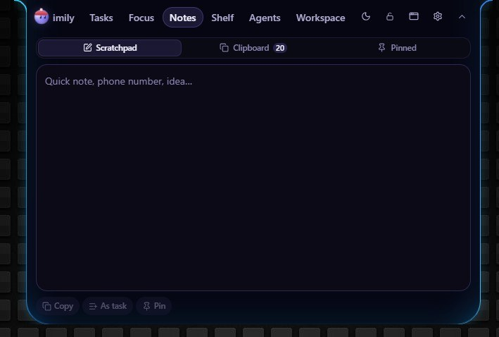
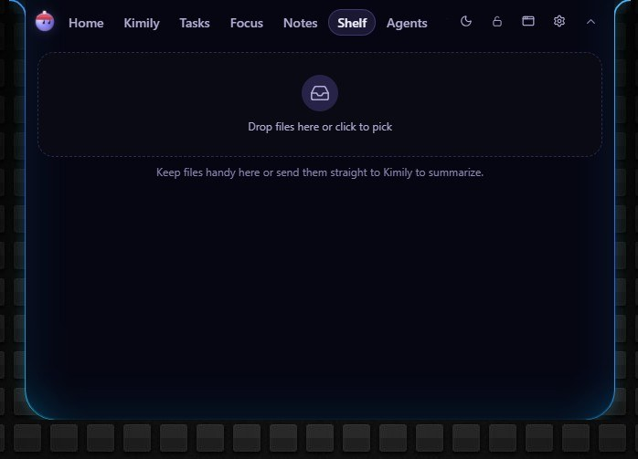
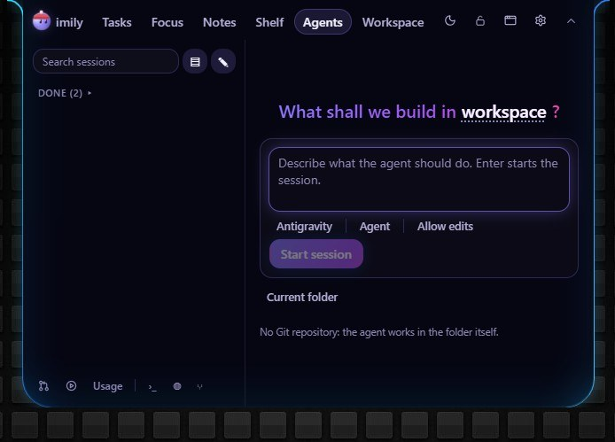
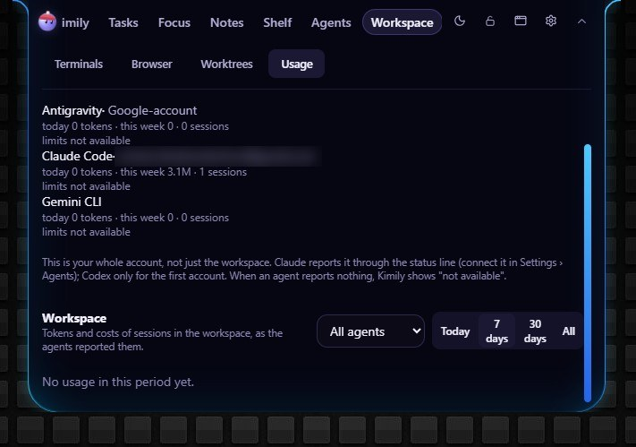
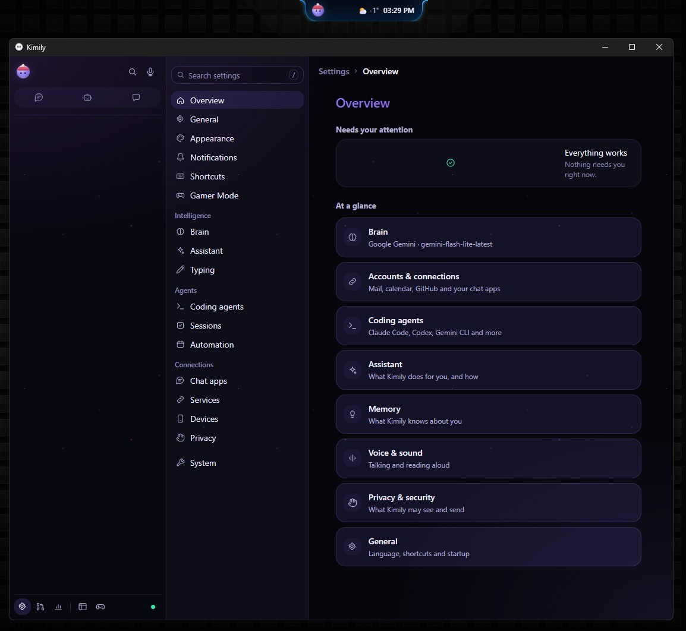

<div align="center">

# Kimily

**A calm Dynamic-Island-style companion for Windows.**
Everything that wants your attention — AI chat, focus timer, tasks, notes, files, music and coding agents — in one quiet pill at the top of your screen.

[**⬇ Download for Windows**](https://github.com/Stephen-the-Creator/Kimily/releases/latest) · [Features](#features) · [Privacy](#privacy) · [Build from source](#build-from-source)


<br />



</div>

## Why Kimily?

Notifications, timers, to-dos and AI chats usually live in five different windows. Kimily collects them in a small pill at the top of your screen that stays out of the way until you need it — then opens into a panel with everything in one place.

It runs on **local AI models by default** (Ollama or LM Studio), so your chats and notes stay on your computer.

## Features

| | |
|---|---|
| 🏝️ **The island** | A pill that shows what matters right now: clock and weather, the song that's playing (with controls), your focus timer, a running agent or your next meeting. Click it and it opens on exactly that. |
| 🤖 **AI chat** | Ask anything from the island. Works with local models (Ollama, LM Studio) and, if you want, cloud models. |
| ⏱️ **Focus timer** | Presets (5 / 15 / 25 / 45 min) or your own `MM:SS`, Pomodoro rounds with short and long breaks, an optional goal, and a progress bar right in the closed pill. |
| ✅ **Tasks** | Add a task with a due date in one line; overdue tasks are highlighted, finished ones fold away. |
| 📝 **Notes & clipboard** | An auto-saving scratchpad, pinned snippets you copy with one click, and a clipboard history that **skips passwords, API keys and card numbers** — with a pause button. |
| 📂 **File shelf** | Drop files on the island to keep them handy, or send them to Kimily to summarize. |
| 🧑‍💻 **Coding agents** | See what Claude Code, Codex & co. are doing and answer their questions without switching windows. |
| 🎨 **Make it yours** | A 3D cat avatar whose eyes follow your pointer (smooth, fluffy or glass), or the classic orb with accessories, 5 island themes (*Obsidian*, *Smoked Glass*, *Tinted*, *Light*, *Neon* with 7 glowing rim colors), 4 panel sizes and tabs you can switch on or off. Dock it at the top (and slide it clear of your browser tabs) or let it float anywhere. |
| 🌍 **5 languages** | English, Deutsch, Nederlands, Français, Español. |

## Screenshots

<table>
  <tr>
    <td width="50%"><br /><sub><b>Focus</b>: presets, your own countdown and Pomodoro rounds with breaks.</sub></td>
    <td width="50%"><br /><sub><b>Tasks</b>: one line per task, or just say it in the chat.</sub></td>
  </tr>
  <tr>
    <td><br /><sub><b>Notes</b>: scratchpad, clipboard history and pinned snippets.</sub></td>
    <td><br /><sub><b>Shelf</b>: drop files to keep them handy or let Kimily summarize them.</sub></td>
  </tr>
  <tr>
    <td><br /><sub><b>Agents</b>: start Claude Code, Codex, Gemini CLI or Antigravity in a folder.</sub></td>
    <td><br /><sub><b>Workspace</b>: terminals, browser, worktrees and token usage per agent.</sub></td>
  </tr>
</table>

<p align="center">
  <br />
  <sub><b>Settings</b>: one window for everything, with the island docked above it.</sub>
</p>

### Keyboard shortcuts

| Shortcut | Action |
|---|---|
| `Alt` + `Space` | Talk to Kimily |
| `Ctrl` + `Alt` + `Space` | Open the chat |
| `Ctrl` + `Alt` + `W` | Open the main window |

All shortcuts can be changed in **Settings › Shortcuts**.

## Install

1. Download **`Kimily.exe`** from the [latest release](https://github.com/Stephen-the-Creator/Kimily/releases/latest).
2. Run it — no installer needed.
3. Windows SmartScreen may warn you because the build isn't code-signed yet. Click **More info → Run anyway**.

**Requirements:** Windows 10 or 11 (64-bit) with the Microsoft Edge WebView2 runtime (included in Windows 11). For local AI, install [Ollama](https://ollama.com) or [LM Studio](https://lmstudio.ai).

## Privacy

- **Local first.** With a local model, nothing you type leaves your computer.
- **Nothing runs without you.** Actions like sending a message or running an agent wait for your approval.
- **Clipboard history stays local** and never stores passwords, keys or card numbers.
- **No tracking.** Kimily has no analytics or telemetry built in.

## Build from source

Prerequisites: [Node.js 20+](https://nodejs.org), [Rust](https://rustup.rs) (stable, MSVC toolchain) and the Visual Studio C++ Build Tools.

```powershell
git clone https://github.com/Stephen-the-Creator/Kimily.git
cd Kimily/apps/tauri
npm install
npm run tauri dev                                   # run with hot reload
npm run tauri build -- --no-bundle -- --jobs 1      # build Kimily.exe (--jobs 1 for PCs with 8 GB RAM)
```

The finished `Kimily.exe` lands in `apps/tauri/target/release/` (or in your `CARGO_TARGET_DIR`, if you set one).

## Credits & license

Kimily is a fork of [**Nook**](https://github.com/IAMichan/Nook) by Michan van der Hoek, adapted and extended for Windows.
The cat avatar is [**Open Bot Avatar**](https://github.com/DominikScholz/open-bot-avatar) by Dominik Scholz (MIT). See [THIRD-PARTY-NOTICES.md](THIRD-PARTY-NOTICES.md).
Released under the [MIT License](LICENSE).
